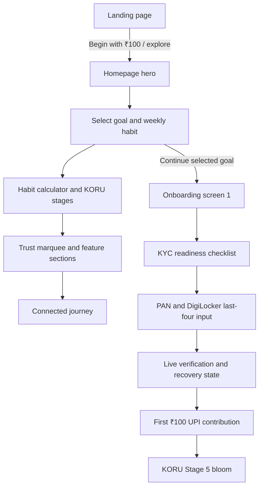

# Sprout 2.0

Sprout 2.0 is a production-style interactive prototype for a mobile-first Indian micro-investing journey. It demonstrates a calm first-investment experience, bilingual English/Hindi content, guided KYC preparation, and a connected path from a web goal to a first UPI contribution.

The prototype uses pure JavaScript and JSX:

- React 18
- Vite
- Tailwind CSS
- `lucide-react`
- Vitest + Testing Library
- No TypeScript
- No Three.js, WebGL, video, or heavy animation runtime

## Experience flow

The application opens with a dedicated landing screen. The visitor can enter with the CTA, click the journey prompt, or use a downward wheel gesture. The landing curtain lifts and fades before the main site is revealed.



## Key features

### Landing and homepage

- Dedicated cinematic landing page shown on first load
- Smooth landing exit transition into the homepage overview
- Responsive editorial hero with Fraunces typography
- Three selectable micro-goal cards:
  - Emergency Cushion — ₹100/week
  - Next Milestone — ₹250/week
  - Long-Term Wealth — ₹500/week
- Selected goal state uses high-contrast Banyan Obsidian with an emerald focus border
- Interactive ₹100–₹1,000 weekly habit slider
- Indian-formatted rolling currency values
- Five-year principal versus illustrative market-linked comparison
- Infinite trust/product marquee
- Scroll-reveal sections for security and journey content
- Explicit 390px mobile preview mode

### KORU sculpture

- Frameless CSS/SVG botanical sculpture
- Four CSS 3D depth planes
- Emerald, obsidian, jade, and Sovereign Gold facets
- Stage evolution from seed to crown bloom
- Cursor-proximity tilt on capable desktop devices
- No visible orange orbit node
- Touch/mobile and low-end fallback without mouse listeners
- CSS breathing animation in optimized mode

### Connected onboarding

- Five-screen responsive mobile frame
- Website goal and amount handoff
- PAN/mobile readiness checklist
- Missing-PAN save-and-remind state
- PAN normalization and format feedback
- DigiLocker simulation using only the last four mobile digits
- Verification heartbeat and registry checklist
- Slow-4G/registry-delay recovery UI
- First ₹100 UPI contribution state
- Stage 5 KORU bloom and referral state

### Localization and compliance

- English and Hindi Devanagari dictionaries
- Instant language switching without a page reload
- Devanagari line-height protection against clipped matras
- `auditComplianceCopy()` scans nested copy dictionaries
- Forbidden financial-assurance wording is rejected:
  - `guaranteed`
  - `safe`
  - `risk-free`
  - `risk free`
- Sticky regulatory disclaimer on every application surface
- Disclaimer font size explicitly set to `12.5px`
- No full government ID is requested or stored

## Project structure

```text
src/
├── App.jsx
├── index.css
├── config/
│   └── sproutStore.js
├── components/
│   ├── LandingPage.jsx
│   ├── Navbar.jsx
│   ├── HomepageView.jsx
│   ├── OnboardingFlow.jsx
│   ├── StickyComplianceBar.jsx
│   └── ui/
│       ├── InfiniteTrustTicker.jsx
│       ├── KoruAvatar3D.jsx
│       ├── RollingCurrency.jsx
│       ├── RollingOdometer.jsx
│       ├── ScrollReveal.jsx
│       ├── SpotlightCard.jsx
│       └── ...
├── __tests__/
│   ├── setup.js
│   └── sprout.test.jsx
└── main.jsx
```

The approved Stitch references and screenshots live in [`design-artifacts/`](./design-artifacts/). Static gallery screenshots are served from [`public/stitch-screens/`](./public/stitch-screens/).

## Setup

Requirements:

- Node.js 18 or newer
- npm 9 or newer

Install dependencies:

```bash
npm install
```

Start the Vite development server:

```bash
npm run dev
```

Open the local URL printed by Vite, normally `http://localhost:5173`.

Create a production build:

```bash
npm run build
```

Run the automated tests:

```bash
npm run test
```

The equivalent direct command is:

```bash
npx vitest run
```

## Verification

The current production build has been validated with:

- 5/5 Vitest tests passing
- Vite production build passing
- No broken imports
- No build warnings
- Browser smoke testing of landing entry, homepage scrolling, goal selection, KORU stage changes, Hindi switching, and onboarding handoff

The latest generated bundle is approximately 62 KB gzipped JavaScript and 7 KB gzipped CSS. These values are build-output observations, not product claims.

## Important implementation notes

- The document remains the single native scroll surface. The landing curtain is fixed only during the entry transition and does not create a second scroll container.
- Horizontal clipping is applied to the React app shell rather than `html` or `body` so vertical document scrolling remains reliable.
- `ScrollReveal` uses `IntersectionObserver` and immediately reveals content when the API is unavailable or optimized mode is active.
- KORU checks `(hover: hover) and (min-width: 768px)` before registering cursor physics.
- All buttons and form controls meet the 48px minimum touch-target requirement through component classes and global input/button rules.
